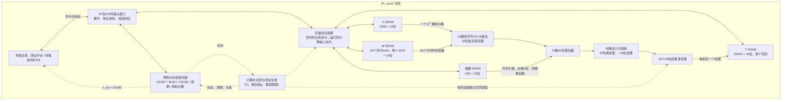
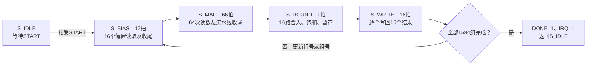

# 前馈第一线性层加速器：模块功能与框架图

本文依据 `sv_ffn_accel/rtl/` 的当前 SystemVerilog 源码解读。

## 1. 整体功能

硬件执行一次固定尺寸的线性变换：

```text
Y[i,j] = sum(X[i,k] × W[k,j], k=0…63) + b[j]

X：99×64    W：64×256    b：256    Y：99×256
```

每行输入有64个特征，经变换得到256个输出特征，共处理99行。
输入、权重、偏置和输出均为有符号16位定点数，小数部分为8位，实数值等于整数编码除以256。
点积使用40位累加器，完成累加后统一舍入和饱和，得到16位结果。

当前范围是前馈网络的第一线性层。激活函数、第二线性层、注意力和完整Transformer计算不在此实现中。

## 2. 总体框架图

实线表示数据或总线事务，虚线表示控制或状态。
图中的接口、控制器和运算通路是顶层内部的功能划分，尚未拆成独立的SV模块。



X、W、b经总线装载。接收到START后，硬件自行计算并将结果写入Y。
软件可以轮询DONE，也可以使用电平中断o_irq；完成后经总线读回Y。
运行时主机访问数据窗口会返回错误，状态寄存器仍可读取。

## 3. 源码中实际定义了哪些模块

| 源码对象 | 位置 | 功能 |
|---|---|---|
| `ffn_accel` | `rtl/ffn_accel.sv` | 加速器顶层，包含总线接口、寄存器、计算状态机、地址调度、16路乘累加、舍入调用和结果写回，并实例化SRAM |
| `ffn_sram_1rw` | `rtl/ffn_sram_1rw.sv` | 基础16位同步单端口存储器；每拍可读或写，不能同时读写；不复位存储数组 |
| `ffn_banked_sram` | 同上 | 用多个基础存储器拼出更深的逻辑存储器，并选择正确的读数据；用于X、b、Y |
| `ffn_numeric_pkg` | `rtl/ffn_numeric_pkg.sv` | SystemVerilog包，提供定点常量与`requantize()`函数；按最接近、半值远离零舍入，并将结果限制到16位有符号范围，返回饱和标记 |

其中有3个`module`定义和1个`package`定义。
`ffn_numeric_pkg`是编译期共享定义，顶层对其函数的16次并行调用构成舍入与饱和逻辑。

顶层实际存储实例关系：

```text
ffn_accel
├─ u_x：ffn_banked_sram
│  └─ 2 × ffn_sram_1rw，单块4096×16位
├─ u_bias：ffn_banked_sram
│  └─ 2 × ffn_sram_1rw，单块128×16位
├─ u_y：ffn_banked_sram
│  └─ 7 × ffn_sram_1rw，单块4096×16位
└─ gen_weight[0…15].u_mem
   └─ 16 × ffn_sram_1rw，单块1024×16位
```

基础存储块共27个，按上述块规格计算共104.5 KiB；X和Y存在未使用容量。
这些仍是RTL存储抽象，官方SRAM宏替换与物理实现尚未完成。

`ffn_banked_sram`中的多个块用于扩展容量，逻辑上仍然单端口。
权重的16个bank则有16条独立读数据通路，用于同时提供16个权重。

## 4. 16路并行到底怎么算

设当前输入行为i，当前输出组为g，16路分别负责列`j=16g…16g+15`。

1. 依次读出本组16个偏置，将`b[j] << 8`预置到对应40位累加器，使偏置与乘积的小数位数一致。
2. 令k从0递增到63。每次读取一个`X[i,k]`，同时从16个权重bank读出`W[k,16g…16g+15]`。
3. 同一个X广播到16个乘法器，各自乘以不同权重。注册乘积后，分别加入对应累加器。
4. 64项累加完成，对16路结果同时舍入和饱和，并存入结果暂存器。
5. Y为单端口存储器，花16拍将这一组结果逐个写入。

例如第一组产生`Y[0,0…15]`，第二组产生`Y[0,16…31]`。
每行16组，完成256列后处理下一行，直到99行全部完成。

权重存储映射为：

```text
bank = j % 16
bank内地址 = k × 16 + floor(j / 16)
```

因此本组16个权重恰好分布在16个不同bank，可以同时读取。
MAC阶段流水线填充后，每拍可完成16次乘累加；偏置读取、流水线收尾和写回也占用周期。

## 5. 控制流程和周期



每组100拍，99行×每行16组=1584组，每次完整运算为158400拍。
该计数从接受START后的第一活动拍开始，包含最后一次Y写入，不包含START接受拍、软件装载或读回时间。
按150 MHz换算，核心运算时间为1.056 ms；此值是周期换算，尚未验证工艺实现能否达到该频率。

顶层还有独立的总线事务状态机`H_IDLE → H_READ → H_RESPONSE`。
同步SRAM读事务经过H_READ等待读数据，寄存器访问和写事务直接进入H_RESPONSE。
响应会保持到主机接受，最多允许一个未完成事务。

## 6. 软件与验证配套

| 文件 | 作用 |
|---|---|
| `driver/ffn_driver.c` | CPU侧驱动示例：装载X/W/b、设置层号、启动、轮询完成、读取Y、清除DONE/IRQ |
| `model/reference.py` | 独立整数参考模型和构造测试数据生成，供比较RTL结果 |
| `tb/tb_ffn_accel.sv` | 通过总线装载和读回数据，检查结果、接口异常和复位行为 |
| `tb/tb_timing_capture.sv` | 采集RTL的真实逐拍信号，为时序动画提供数据 |
| `scripts/run_sim.py` | 组织测试数据生成、RTL编译和功能仿真 |
| `constraints/ffn_accel.sdc` | 150 MHz目标时钟和接口约束模板 |

12层复用同一硬件，每次由软件重新装载对应的X/W/b；`LAYER_TAG`只记录层号。
当前没有DMA，数据搬运由主机完成；E203尚未完成实际集成运行。

既有验证报告记录12套构造输入、304128个输出逐位比较零差异，每次核心周期158400拍。
这证明所测功能与整数参考模型一致，真实预训练模型精度、工艺时序、面积与功耗仍待验证。
本次解读未修改RTL或重新执行功能仿真。
